# Evidências visuais

Capturas do commit `142b9c2`, em Chromium, com Barlow, Barlow Condensed e IBM Plex Mono carregadas. Os cabeçalhos estão em 1440 px e sem faixa de demonstração acima da barra. As telas principais usam os exemplos fictícios incorporados.

[Voltar ao diagnóstico](../analise-visual.md) · [Medições](medicoes.json) · [Continuidade do tema](continuidade-tema.json)

## Cabeçalhos — comparação nos dois temas

A largura final de exibição no GitHub pode reduzir as imagens. Abrir cada arquivo permite conferir na resolução original. Os temas nas capturas de Paradas refletem o tema do sistema usado na sessão; a divergência na preferência compartilhada está registrada no JSON de continuidade.

### Portal

**Claro**

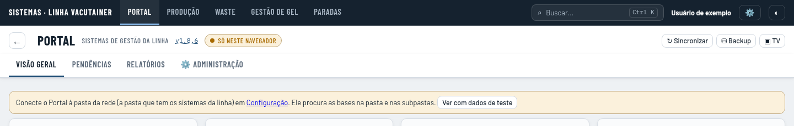

**Escuro**

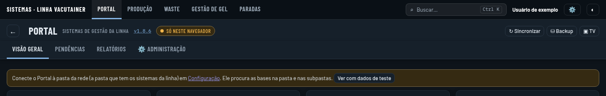

### Produção

**Claro**

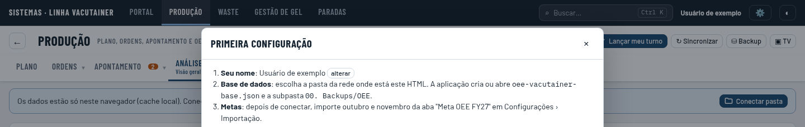

**Escuro**

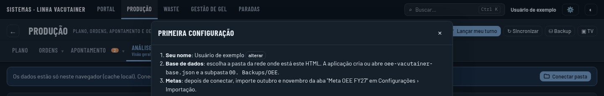

### Waste

**Claro**

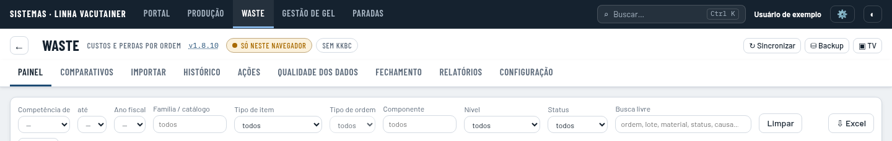

**Escuro**

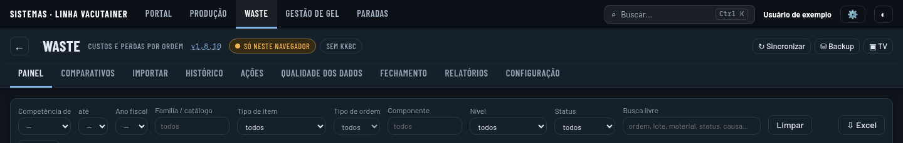

### Gestão de Gel

**Claro**

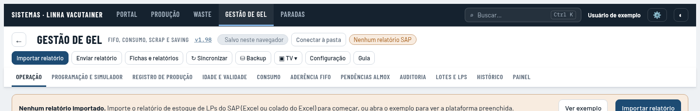

**Escuro**

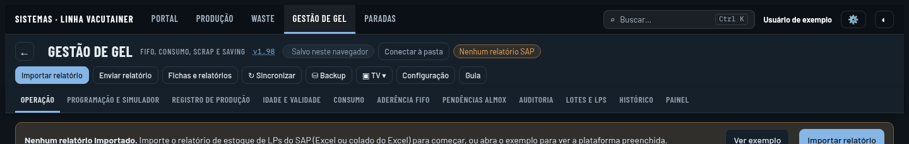

### Paradas

**Claro**

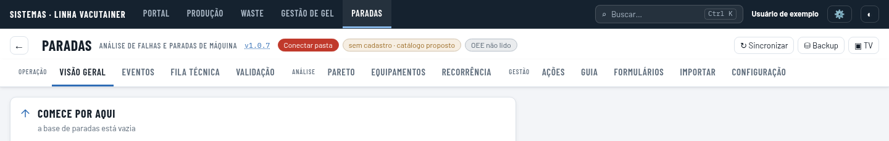

**Escuro**

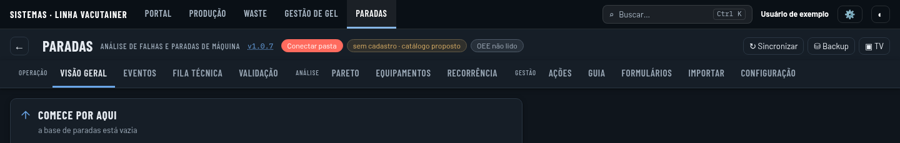

## Telas principais — exemplos em 1440 px

### Portal

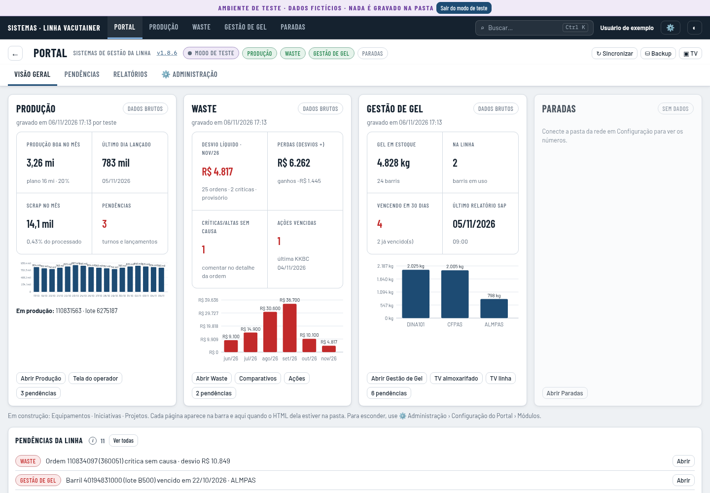

### Produção

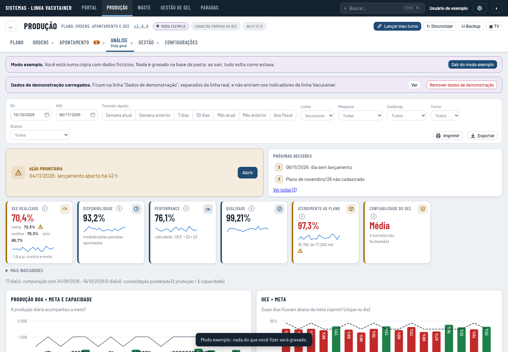

### Waste

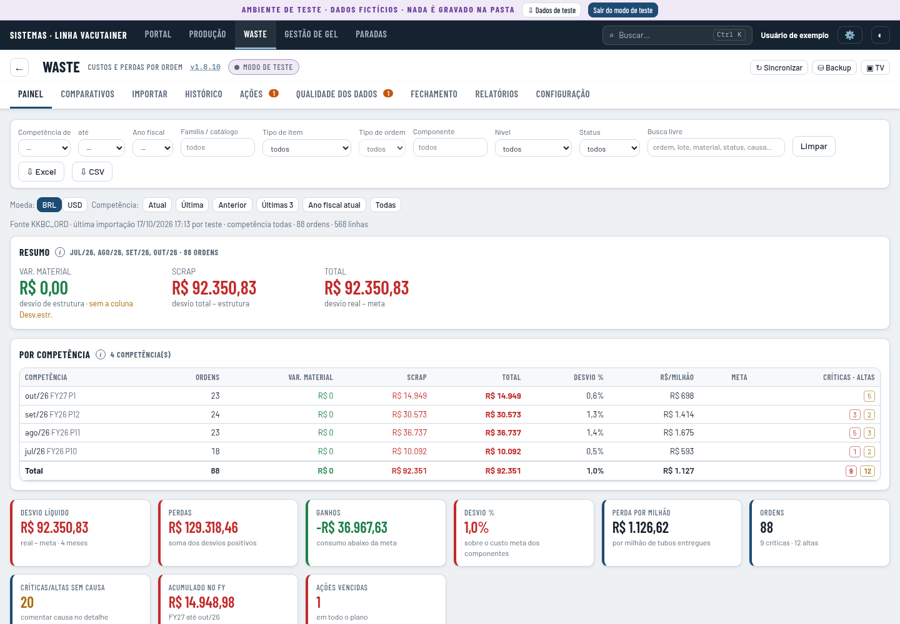

### Gestão de Gel

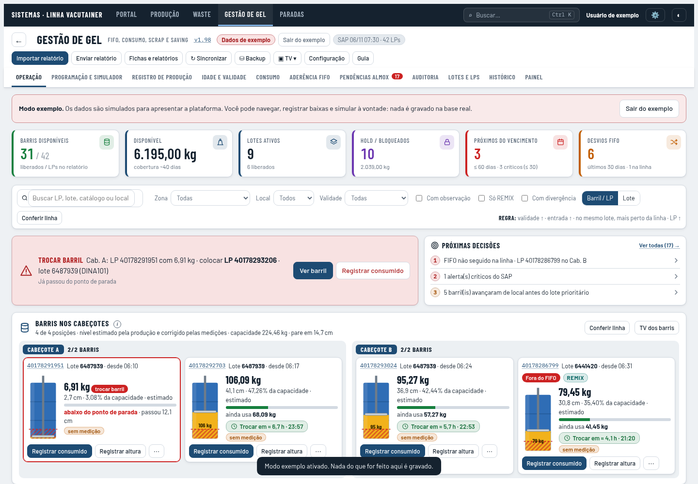

### Paradas

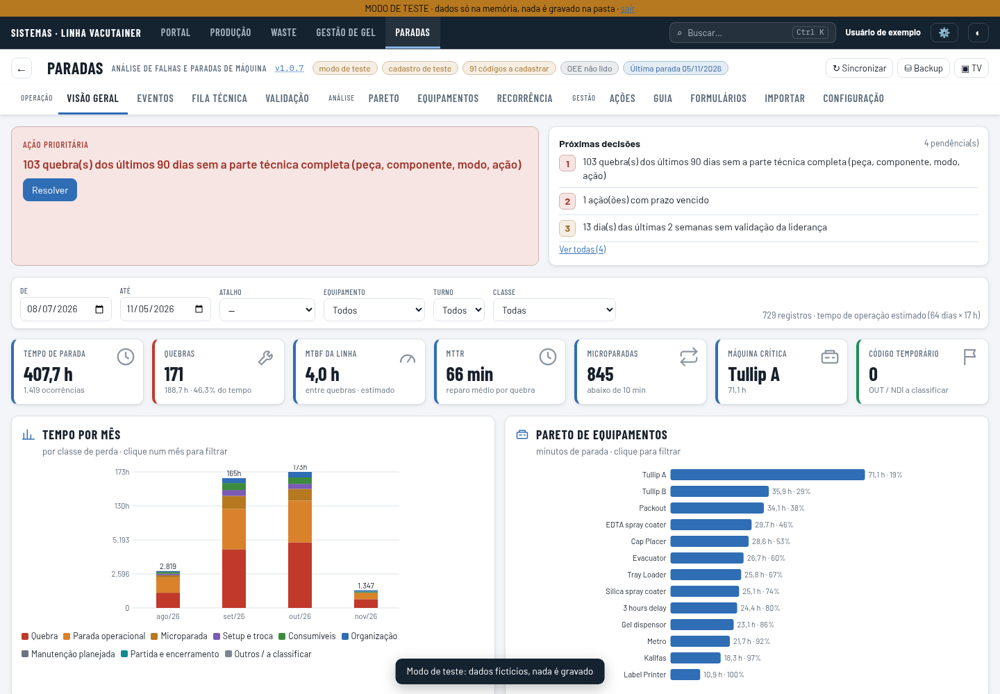

## Gestão de Gel — 390 px

Esta captura mostra a margem externa, a concentração de ações e as abas distribuídas em várias linhas.

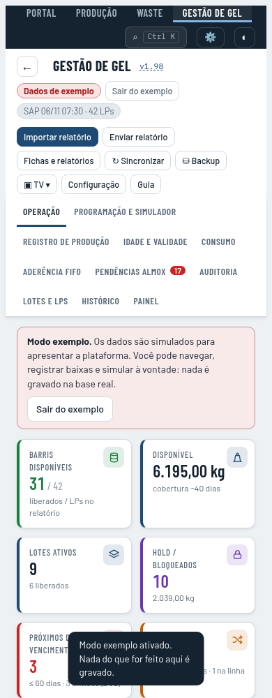

## Continuidade do tema

A reprodução usa o tema do sistema claro. O Portal é colocado em escuro pelo botão da interface. Ao abrir Paradas, o fundo volta ao claro. Ao selecionar escuro em Paradas, a chave é gravada com aspas; o Portal deixa de reconhecer a preferência na volta. Os valores exatos estão em [continuidade-tema.json](continuidade-tema.json).
