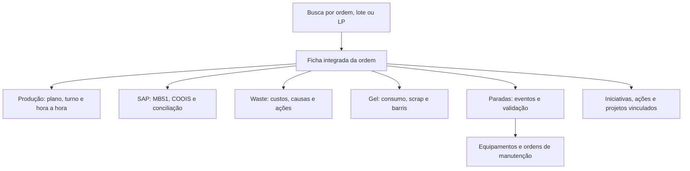

**Diagnóstico técnico e de produto — portelarwh/vacutainer**

Análise de 08/11/2026. Referência: branch `main`, commit `e0435136359847e07a2a775a1d7eea31371495b8`. A análise não alterou o código da aplicação nem dados reais e não publicou mudanças no GitHub.

**1. Minha avaliação do sistema**

O sistema já tem uma base funcional relevante: cadastro central, vigências, importações SAP, cálculo de OEE, tratamento de perdas, controle de gel, análise de paradas, backups, auditoria, relatórios e testes. Não recomendo descartá-lo ou começar outra aplicação do zero.

A principal lacuna é que a unidade de trabalho ainda é a página. Para cumprir seu objetivo, a unidade de consulta precisa ser a **ordem**, com ligações explícitas a lotes, materiais, dias, turnos, eventos, equipamentos, barris e ações. Hoje existem trechos dessa integração, mas os caminhos, as janelas de histórico e os contratos ainda são incompletos.

Minha prioridade seria: **proteger os dados → fechar os contratos de integração → entregar a ficha única da ordem → simplificar as jornadas por perfil → construir os módulos novos**. Uma interface mais bonita, sozinha, não resolve os primeiros três pontos.

Encontrei defeitos novos e confirmei pendências conhecidas. Os mais graves estão na gravação de `ordens-base.json`. Na reprodução com pasta simulada, uma falha de leitura permitiu sobrescrever a base com uma cópia antiga e remover uma competência que existia na cópia remota.

**2. O que foi examinado e o que foi validado**

Li as oito páginas, os módulos e geradores em `fontes/`, contratos de integração, planos de evolução, documentação dos módulos, testes e o registro de decisões das auditorias anteriores. Usei os documentos para reconstruir o contexto; as conclusões de comportamento foram conferidas no código e, nos achados abaixo, por cenários reproduzíveis.

O histórico anterior não está inteiramente perdido. Estes documentos recuperam decisões importantes:

- [Regras e estado atual do projeto](/workspace/vacutainer/CLAUDE.md).
- [Registro de decisões das auditorias](/workspace/vacutainer/docs/auditorias/registro-decisoes.md).
- [Plano de evolução](/workspace/vacutainer/docs/plano-evolucao-plataforma.md).
- [Situação das páginas em construção](/workspace/vacutainer/docs/paginas-construcao.md).
- [Arquitetura de OSM](/workspace/vacutainer/docs/osm-arquitetura.md).

Executei as suítes existentes `tpg`, `tintegra`, `tdiag`, `tseguranca`, `tvisual`, `tconstrucao`, `tbases` e `trelatorios`. As oito terminaram sem erros. A suíte visual percorreu oito páginas, dois temas e cinco larguras; os testes de relatórios verificaram PDFs e impressão, além de conteúdo copiado. Os geradores também foram conferidos em cópias temporárias pela suíte de segurança.

O Chromium disponível bloqueia navegação `file://`. Para executar as suítes, servi os mesmos arquivos por HTTP local e selecionei o Chromium do ambiente por um adaptador temporário, sem alterar os testes ou o produto. Portanto, estes resultados **não homologam a execução por arquivo na rede corporativa**. Gravações foram testadas com pastas simuladas e OPFS; não houve acesso à pasta real, ao SAP da empresa ou a duas estações reais. Também não executei toda a coleção de testes legados.

Os cenários adicionais e os logs estão na pasta [evidências](/workspace/diagnostico-vacutainer/evidencias/reproducoes.json). Passar nas suítes atuais não elimina defeitos em cenários que elas ainda não cobrem.

**3. Estado real de cada módulo**

| Módulo | O que existe | Limitação principal |
|---|---|---|
| Portal | Visão geral, pendências, relatórios, Administração, cadastro, usuários/perfis, vigências e versões | Ainda não oferece consulta completa da ordem nem conciliação transversal de todos os módulos |
| Produção | Plano, lançamento, hora a hora, OEE, lotes MES, análise, relatórios, MB51/COOIS e conciliação | Publicação dos eventos individuais e histórico integrado de ordens incompletos; gravação auxiliar precisa de correções |
| Waste | KKBC, comparativos, ações, qualidade dos dados, fechamento, relatórios, detalhe de ordem e consultas a Gel/Produção | Integração usa buscas genéricas, há perda de contexto nos links e problemas com competência/vigência |
| Gestão de Gel | Operação, FIFO, validade, consumo, auditoria, produção, programação/simulador, lotes/LPs | Ainda mantém cadastros e produção parcialmente próprios; integração OEE → Gel pendente |
| Paradas | Eventos, fila técnica, validação, Pareto, equipamentos, recorrência, ações, guia, formulários e importação | Ainda aguarda eventos publicados pela Produção; sem consulta completa por ordem e relatório próprio |
| Equipamentos | Estrutura visual e abas planejadas, com atalhos para funções existentes em outros módulos | Ainda não há módulo operacional nem base própria implementada |
| Iniciativas | Estrutura de 5S, OSM e KAS, com subabas planejadas | Ainda não registra observações, auditorias ou iniciativas reais |
| Projetos | Estrutura e abas provisórias | Escopo e persistência ainda precisam ser construídos |

As três últimas páginas são protótipos de navegação. Não devem ser apresentadas como funcionalidades já disponíveis.

**4. Defeitos e riscos comprovados: problema, localização, motivo e correção**

Prioridades: **P1** = integridade, recuperação ou perda de dados; **P2** = informação incorreta/incompleta, integração ou rastreabilidade; **P3** = manutenção e ergonomia. A prioridade indica a ordem recomendada, não a frequência comprovada na operação real.

**F01 — P1 — Ordens pode sobrescrever a base depois de falhar a leitura prévia. Novo achado.**

- **Onde:** [FolderBackend.readSibling](/workspace/vacutainer/fontes/producao/OEE-base-2.0.html:1618), a inclusão de `writeSibling` no [build](/workspace/vacutainer/fontes/producao/build.py:58) e [Ord.gravar](/workspace/vacutainer/fontes/producao/ordens_tela.js:26).
- **Problema:** `readSibling` captura qualquer exceção e devolve `null`. `Ord.gravar` interpreta esse retorno como inexistência da base e prossegue com o conteúdo local. Falha de rede, permissão ou leitura fica indistinguível de arquivo ausente.
- **Reprodução:** a base remota tinha setembro e outubro; a cópia local tinha apenas setembro. Injetei `NotReadableError`. O método realizou uma escrita, não lançou erro e o arquivo final ficou somente com setembro. Outubro deixou de existir nesse arquivo; recuperação dependeria de outra cópia/backup disponível.
- **Por que corrigir:** viola a regra do projeto de não gravar sem ler a base antes. As proteções da base principal do OEE não cobrem automaticamente sua base auxiliar de Ordens.
- **Como:** devolver ausência somente para erros reconhecidos de arquivo inexistente; propagar os demais. Ao falhar a leitura, preservar a alteração local como pendente e impedir a escrita. Distinguir criação de base de indisponibilidade temporária.
- **Aceite:** erro de leitura gera zero escritas; competências remotas permanecem intactas; a alteração local pode ser recuperada e reenviada com segurança.

**F02 — P1 — Ordens encerra a gravação sem confirmar o arquivo persistido. Pendência conhecida, reproduzida.**

- **Onde:** [Ord.gravar](/workspace/vacutainer/fontes/producao/ordens_tela.js:40).
- **Problema:** depois de `writeSibling`, não há releitura de `revId`/conteúdo. O método limpa `audPend` e retorna sucesso.
- **Reprodução:** outra sessão substituiu o arquivo imediatamente depois da escrita. Houve somente uma leitura, antes da gravação. O método retornou sem erro e limpou a fila, embora o `revId` remoto fosse de outra sessão.
- **Por que corrigir:** quem importou pode receber a mensagem de competência gravada quando seu conteúdo já foi substituído. O registro anterior adiava isso para a próxima mudança em Ordens; a nova revisão do fluxo deve incluí-lo.
- **Como:** reler e confirmar identidade da gravação, manter o pacote da importação até a confirmação e sinalizar conflito. Competências diferentes podem ser reaplicadas; duas importações que alteram a mesma competência precisam de uma regra explícita para não sobrescrever silenciosamente o trabalho uma da outra.
- **Aceite:** colisão simulada não resulta em sucesso falso; operação pendente só é retirada depois da confirmação.
- **Limite:** a releitura reduz os erros detectáveis, mas arquivos compartilhados não oferecem a mesma transação de um banco de dados.

**F03 — P1 — Substituição de competência continua após falhar o backup. Novo achado.**

- **Onde:** [backup de Ordens](/workspace/vacutainer/fontes/producao/ordens_tela.js:38).
- **Problema:** mesmo em `motivo === 'substituição'`, uma falha de `backupSub` é capturada apenas com `console.warn`; a substituição continua.
- **Reprodução:** fiz o backup lançar “acesso negado”. O código tentou um backup, realizou uma escrita e retornou sucesso com a competência substituída.
- **Por que corrigir:** substituir uma importação remove do estado ativo a versão anterior, justamente quando uma cópia de recuperação é necessária. É um cenário distinto do backup diário automático do Portal já adiado no registro.
- **Como:** tornar obrigatório o backup anterior à substituição. Falha mantém a prévia e mostra um erro recuperável. Usar nome com segundos/milissegundos ou identificador único: o nome atual chega apenas ao minuto e pode colidir em substituições sucessivas da mesma competência.
- **Aceite:** backup que falha impede a substituição; duas substituições próximas preservam cópias distintas.

**F04 — P2 — Backups antigos da Produção aparecem, mas não são lidos pelo caminho correto. Novo achado.**

- **Onde:** dois métodos `readBackup` no mesmo objeto: [primeiro](/workspace/vacutainer/fontes/producao/OEE-base-2.0.html:1616) e [segundo](/workspace/vacutainer/fontes/producao/OEE-base-2.0.html:1620).
- **Problema:** o segundo substitui o primeiro em JavaScript e ignora o argumento `legacy`. A listagem e os botões ainda suportam o indicador de backup antigo.
- **Reprodução:** ao pedir um backup legado existente em `00. Backups/`, o código tentou somente `00. Backups/OEE/` e retornou `NotFoundError`.
- **Por que corrigir:** compromete download/restauração de cópias antigas no momento de recuperação. Não demonstrou dano ao conteúdo do backup existente.
- **Como:** manter uma única implementação, respeitando `legacy`, e testar os dois diretórios. Uma verificação de chaves duplicadas em objetos também encontraria esse erro.
- **Aceite:** backup antigo listado pode ser baixado e restaurado; backup novo continua usando a subpasta OEE.

**F05 — P2 — Meta do Waste é a de hoje ao consultar um mês antigo. Pendência conhecida, reproduzida.**

- **Onde:** [portalCad/CFG](/workspace/vacutainer/paginas/Perdas-Ordem.html:919), consumidores em `renderResumo`, `trendSerie` e [docMensal](/workspace/vacutainer/paginas/Perdas-Ordem.html:2188).
- **Problema:** `vacMetaArea('WASTE-MES', todayISO())` fornece uma única meta para meses diferentes; alguns resumos multiplicam esse valor pela quantidade de meses.
- **Reprodução:** meta de R$ 10 mil até outubro e R$ 20 mil a partir de novembro. Para outubro, a meta histórica correta era R$ 10 mil, mas `CFG()` forneceu R$ 20 mil.
- **Por que corrigir:** um relatório histórico pode mudar de avaliação quando a meta nova entra em vigor, sem qualquer alteração nos resultados daquele mês.
- **Como:** obter a meta por competência com uma regra de referência documentada; em período de vários meses, somar as metas vigentes de cada competência. Se houver mudança dentro do mês, explicitar a regra aplicável antes de programar proporcionalidade.
- **Aceite:** outubro mantém sua meta após a entrada da vigência de novembro; tela, gráfico e relatório usam a mesma regra.

**F06 — P2 — Alguns leitores do Waste aceitam uma versão de integração desconhecida. Novo achado.**

- **Onde:** [loadOrdens](/workspace/vacutainer/paginas/Perdas-Ordem.html:1587), [oeeFind](/workspace/vacutainer/paginas/Perdas-Ordem.html:1608) e, por padrão semelhante, [Ord.lerWaste](/workspace/vacutainer/fontes/producao/ordens_tela.js:64).
- **Problema:** o Portal e o leitor do Gel já possuem proteção para versões desconhecidas, mas esses outros pontos consomem o bloco diretamente.
- **Reprodução:** `exportsVersion: 99` com ordem sintética foi aceito por `oeeFind` e `loadOrdens`; o catálogo e o tipo `Z999` foram usados como informação normal. Não foi uma validação de todas as combinações de versões da plataforma.
- **Por que corrigir:** uma evolução de contrato pode mostrar dados com significado diferente sem avisar. A lacuna também importa para a ficha única proposta.
- **Como:** validar versão e formato em cada entrada; diferenciar dado incompatível, ausente e ilegível; não fazer busca genérica por campos em um contrato incompatível. Centralizar o validador no código-fonte comum, preservando os HTML autônomos distribuídos.
- **Aceite:** versões suportadas continuam funcionando; versão desconhecida gera aviso explícito, sem alimentar indicadores ou classificações.

**F07 — P2 — Uma ordem em mais de uma competência perde informações no índice do Waste. Novo achado.**

- **Onde:** [Map criado por loadOrdens](/workspace/vacutainer/paginas/Perdas-Ordem.html:1590).
- **Problema:** `m.set(ordem, ...)` substitui o registro anterior sem guardar competência. O resultado depende da ordem dos elementos recebidos.
- **Reprodução:** a mesma ordem tinha COOIS com tipo `ZP01` em outubro; a linha de novembro não tinha COOIS. Depois de carregar as duas, a tela passou a informar “sem dado do COOIS”.
- **Por que corrigir:** pode alterar filtros por tipo de ordem e classificações, além de ocultar informação disponível. Também impede tratar corretamente uma ordem que atravessa meses.
- **Como:** indexar por ordem e competência, manter o histórico e escolher o registro adequado ao período da linha consultada. Quando um campo deva ser consolidado, definir precedência explícita, com origem; não assumir que o último item do array é o melhor.
- **Aceite:** inverter a ordem do array não muda o resultado; consultar outubro e novembro mostra os dados correspondentes; ausência de COOIS em um mês não apaga silenciosamente o de outro.

**F08 — P2 — Dias de um lote podem não aparecer no detalhe do Waste. Novo achado.**

- **Onde:** [consulta a server.dayLot](/workspace/vacutainer/paginas/Perdas-Ordem.html:1617). O formato de origem é construído em [marcação do lote por dia](/workspace/vacutainer/fontes/producao/OEE-base-2.0.html:7790).
- **Problema:** a chave tem formato `data|lote`, mas o leitor procura o lote apenas no texto do valor. Esse valor pode conter somente `kind`, `by` e `at`.
- **Reprodução:** existiam as chaves `2026-11-03|6279776` e `2026-11-04|6279776`; nenhum dia foi encontrado no detalhe da ordem.
- **Por que corrigir:** o usuário não consegue consultar todos os dias e suas marcações normal/retrabalho a partir da ordem.
- **Como:** no reparo imediato, interpretar a chave e comparar o lote inteiro. Na integração definitiva, publicar `dias[]`/trechos no `exports` da Produção e retirar a leitura de `server.dayLot` pelo Waste. Evitar correspondência por substring.
- **Aceite:** todos os dias do lote correto aparecem; lotes com números parcialmente iguais permanecem separados.

**F09 — P2 — Links de integração perdem o item selecionado. Novo achado.**

- **Onde:** [oeeBlock](/workspace/vacutainer/paginas/Perdas-Ordem.html:1640) e [gelBlock](/workspace/vacutainer/paginas/Perdas-Ordem.html:1787).
- **Problema:** o LP é mostrado como link, mas seu endereço abre apenas `Gestão-Gel-Vacutainer.html`. “Abrir o OEE” também abre somente a página. Os destinos já suportam links de item.
- **Reprodução:** o link do LP `40194830745` não continha `#lp=40194830745`; o link para Produção não continha ordem nem dia.
- **Por que corrigir:** obriga o usuário a pesquisar de novo e rompe a continuidade que você pediu.
- **Como:** montar links pelo gerador comum, codificando os identificadores; LP → `#lp=…`, ordem → `#ordem=…`, dia → `#dia=…`. Ampliar os leitores de rota para preservar período, turno, equipamento, origem e retorno com filtros.
- **Aceite:** um clique abre o registro exato, e voltar preserva a consulta anterior.

**F10 — P2 — Versões da tela, do código e da base divergem. Novo achado.**

- **Onde:** [APP_VER do Waste](/workspace/vacutainer/paginas/Perdas-Ordem.html:780), `PAGE.versao` na linha 783; [rótulo fixo do Gel](/workspace/vacutainer/paginas/Gestão-Gel-Vacutainer.html:880) e `APP_VERSION` na linha 1272.
- **Problema confirmado:** Waste declara `PAGE.versao = 1.8.16`, mas mostra e grava `1.8.15`. Gel declara `2.04`, mas o cabeçalho mostra `v2.01`.
- **Por que corrigir:** o suporte e o diagnóstico de implantação podem concluir que uma página está desatualizada ou que uma base foi gravada por outra versão.
- **Como:** uma fonte de versão por módulo alimenta cabeçalho, metadados da página, exportação e base; quando houver necessidade de o Portal ler um literal no HTML, gerá-lo no build. Validar a igualdade na geração/teste.
- **Aceite:** tela, metadados e nova base registram a mesma versão. Não reescrever versões de bases antigas apenas para esconder a divergência.

**F11 — P2 — O checkout não inclui a biblioteca de Excel necessária ao uso sem internet. Pendência conhecida.**

- **Onde:** [fallback de loadXLSX](/workspace/vacutainer/paginas/Perdas-Ordem.html:1043), leitores equivalentes dos outros módulos e pasta `paginas/lib/`.
- **Problema:** `xlsx.full.min.js` não está versionado; o carregamento tenta uma cópia local e depois um CDN. O registro menciona a versão local desejada 0.20.3; o fallback atual do Waste usa 0.18.5.
- **Reprodução:** numa página nova, com `window.XLSX` ausente, coloquei o navegador offline antes de pedir a biblioteca. `loadXLSX` falhou com a mensagem de biblioteca indisponível. Com acesso ao CDN, o mesmo carregamento funcionou.
- **Por que corrigir:** uma instalação nova do repositório depende da internet para essa função; a versão efetivamente usada pode variar entre estações. Isso não prova que a pasta real esteja sem o arquivo, pois ela não foi acessada.
- **Como:** incluir uma distribuição aprovada da biblioteca e sua licença na entrega, conferir versão/hash e testar em navegador novo sem acesso externo. Preservar colagem/CSV como alternativa.
- **Aceite:** importação/exportação XLSX funciona numa instalação limpa sem CDN; a tela de diagnóstico informa a versão real carregada.

**5. Lacunas de integração que ainda precisam virar funcionalidades**

Estas lacunas têm relação direta com o seu pedido, mas não devem ser confundidas com regressões novas:

| Lacuna e onde está | Por que importa | O que implementar |
|---|---|---|
| Produção publica `paradasEquipamento` agregado, mas Paradas espera `paradasEventos` individuais | Sem evento individual, não se conecta ordem → parada → equipamento com identidade confiável | Publicar eventos com identificador estável, origem, horário, ordem/lote quando conhecidos e estado de validação; migrar deduplicação para identidade |
| `exports.ordens` da Produção cobre mês atual e anterior; lotes têm janela de 150 dias | Uma ordem antiga pode parecer sem informação apesar de existir na base | Índice histórico e forma de consultar detalhes fora da janela; mostrar cobertura de datas |
| Waste ainda lê `monthPlans` e `server` da Produção | Alterar internamente a Produção pode quebrar a consulta do Waste | Completar o contrato publicado e retirar dependência de estruturas privadas por etapas |
| Gel ainda tem produção e parte dos cadastros próprios | Exige digitação repetida e permite números divergentes | Produção é fonte dos tubos bons, abonos e calendário; Gel guarda complementos de consumo, pesagem e LPs |
| Paradas aceita links de evento/equipamento, mas a rota não trata consulta completa por ordem nem contexto combinado | A ordem não é um caminho universal para investigar falhas | Filtro por ordem/lote com vínculo explícito, roteamento comum e aviso para associação inferida |
| Ações estão distribuídas e os módulos novos ainda não têm persistência | O gestor precisa procurar responsabilidades em vários lugares | Visão consolidada de ações que respeite o dono de cada registro e leve ao ponto de edição |
| Paradas não tem relatório próprio de análise | A impressão da aba existe, mas não atende igualmente liderança, manutenção e reunião | Relatórios de Pareto, recorrência, eventos e MTBF/MTTR, com critérios e tabela detalhada |
| Cadastro compartilhado depende de cópia no navegador por decisão atual | A pessoa precisa saber quando a cópia está desatualizada | Mostrar revisão/origem e última sincronização; não tratar esse desenho como um novo defeito de autenticação |

A deduplicação por proximidade já teve correções. Não afirmo que há hoje uma contagem dupla geral reproduzida: falta o contrato individual para concluir essa integração e eliminar ambiguidades futuras.

**6. Como eu faria a consulta integrada por número da ordem**

Minha primeira entrega de produto seria **Rastreabilidade**, uma nova aba do Portal, com a mesma ficha disponível em painel lateral nas outras páginas. A importação de MB51/COOIS continua em Produção › Ordens. Assim, o usuário consulta a ordem pelo mesmo caminho independentemente de querer analisar produção, gel, perda ou parada.

Não criaria imediatamente um nono HTML. A ficha pode ter endereço completo, como `Portal.html#ordem=110834720`, abrir em nova aba e também ser reutilizada lateralmente. Uma página física própria só seria necessária se a consulta crescesse a ponto de justificar navegação e manutenção separadas.

**Cabeçalho:** ordem como texto, catálogo/material, descrição, lote(s), quantidade com unidade, início/fim, competências envolvidas, situação e qualidade dos vínculos. Uma ordem pode atravessar meses e ter vários lotes; um lote pode consumir vários LPs. O modelo não deve impor um único lote por ordem.

**Abas da ficha e a razão de cada uma:**

| Aba | Conteúdo | Por que existe |
|---|---|---|
| Resumo | Planejado, produzido, custo, paradas, gel e pendências principais | Responder rapidamente como a ordem está |
| Produção | Plano, revisões, turnos, horas, boas, scrap e trechos de execução | Explicar de onde saiu o realizado e permitir investigar desvios |
| Paradas | Eventos, minutos, equipamentos, códigos e validação | Encontrar as causas do tempo perdido sem sair procurando em outra tela |
| Materiais e Waste | BOM vigente, custo meta/real, componentes, causas e período de custo | Separar análise física e financeira, preservando competência |
| Gel e LPs | Barris consumidos, kg, g/tubo, scrap e vínculos de lote | Fechar a rastreabilidade de insumo até a ordem |
| Dados SAP | Movimentos, estornos, situação COOIS, data principal e cobertura | Conferir a fonte oficial e as divergências |
| Ações e melhorias | Ações, OS de manutenção, iniciativas e projetos relacionados | Transformar o diagnóstico em execução acompanhável |
| Histórico | Importações, correções, fechamentos, origem e responsáveis | Explicar como o estado atual foi formado |

O resumo não deve somar automaticamente perdas financeiras de fontes diferentes: custo já contabilizado no Waste pode conter o efeito de um scrap de gel. Somar os dois como “perda total” geraria dupla contagem. Também não somaria OEE de máquinas nem faria média simples de percentuais para obter OEE da linha.

**Regras para essa integração funcionar:**

1. Identificadores normalizados de forma comum, preservados como texto. Ordem, lote e LP são chaves de negócio; ordem de produção e OS de manutenção são entidades diferentes.
2. Um dono para cada dado. A ficha só consulta; editar leva ao módulo responsável. O Portal não recalcula o OEE nem passa a gravar bases de outras páginas.
3. Relações explícitas: ordem–lote, lote–trecho, trecho–turno, evento–equipamento, consumo–LP–ordem, ação–origem. Cada vínculo informa se veio do SAP, lançamento confirmado ou inferência.
4. Dividir um evento/produção entre ordens somente com regra justificável de tempo e quantidade. Dois registros no mesmo dia não provam relação. “Vínculo a confirmar” é preferível a uma atribuição silenciosa.
5. Contratos aditivos no início. Acrescentar blocos opcionais compatíveis ao v1 não exige renumerar tudo. Mudança real de significado exige nova versão com produtores e leitores preparados; os leitores atuais rejeitam versões desconhecidas.
6. Cobertura histórica explícita. Distinguir “zero”, “sem informação”, “fora do período publicado”, “desatualizado”, “incompatível” e “falha de leitura”.
7. Links e retorno padronizados. Preservar ordem, lote, período, turno, equipamento e tela de origem. Usar um leitor comum de parâmetros, mantendo os links atuais funcionando.
8. Fonte, revisão e instante por bloco. Uma consulta pode reunir bases atualizadas em momentos diferentes; isso precisa aparecer sem obrigar a pessoa a abrir Administração.

**Critério de entrega:** digitar uma ordem, ver tudo o que os módulos sabem sobre ela, abrir qualquer item exato e voltar sem perder filtros. A mesma ordem deve produzir os mesmos números na ficha, na página responsável e no relatório com os mesmos critérios.

**7. O que eu implementaria em cada página, incluindo o motivo**

As propostas abaixo complementam funções já existentes; não são uma lista de botões para acrescentar todos ao topo. O conteúdo avançado deve aparecer conforme a tarefa e o perfil.

**Portal e Administração**

| Página/aba | Melhoria | Motivo |
|---|---|---|
| Visão geral | Quatro a seis indicadores principais, pendências prioritárias e atualização por origem; abrir detalhe ao clicar | Dar uma leitura rápida sem misturar resumo com investigação completa |
| Rastreabilidade — nova | Busca de ordem/lote/LP e ficha integrada | Atender ao seu objetivo principal de uma entrada única |
| Pendências | Responsável, prazo, origem, severidade e “minhas pendências”; agrupamento de ocorrências relacionadas | Mostrar o próximo trabalho concreto e evitar listas repetidas |
| Central de ações — visão nova | Agregar ações de Waste, Paradas, Iniciativas, manutenção e projetos; edição no módulo dono | Acompanhar execução sem criar uma segunda cópia das ações |
| Relatórios | Modelos por público: turno, reunião diária, mensal da gerência e diretoria | Evitar que cada pessoa monte o mesmo relatório do zero |
| Administração › Integrações | Cobertura e última importação de MB51, COOIS, KKBC, CS12, MES e Forms; atalhos para importar | A pessoa precisa saber o que falta atualizar antes de confiar no consolidado |
| Administração › Diagnóstico/Versões | Ampliar a tela existente com compatibilidade, revisão do cadastro, falhas de backup e defasagem entre bases | Corrigir a origem das inconsistências sem criar outra tela quase igual |
| Administração › Calendário e vigências | Exibir calendário compartilhado e regras vigentes, mantendo a Produção como dona operacional | Tornar visíveis as regras que mudam metas e disponibilidade |

**Produção**

| Página/aba | Melhoria | Motivo |
|---|---|---|
| Lançamento / meu turno | Cabeçalho compacto com ordem/lote, catálogo, turno e situação; rascunho, validação no campo e ação principal “Concluir turno” | Reduzir erros de contexto e orientar o operador |
| Hora a hora | Mostrar os trechos de ordem e trocas; sugestões do MES com aceite e origem | Ligar quantidade e tempo à ordem correta, sem tirar a decisão do usuário |
| Plano | Calendário de capacidade, previsto × realizado, mudanças com motivo, restrições de material/gel | Ajudar a decidir sequência e recuperação de plano |
| Ordens › MB51/COOIS | Corrigir F01–F03, mostrar pacote de importação, cobertura e conciliação por competência | A importação precisa ser recuperável e verificável |
| Ordens / lotes | Linha do tempo da execução e vínculo confirmado entre ordem, lote, trechos e datas | Resolver ordens que atravessam turnos, meses e interrupções |
| Pendências | Separar lançamento faltante, conferência da liderança e divergência MES/SAP; manter responsável e resolução | Cada pendência requer uma ação diferente |
| Análise / Visão geral / Painel | Indicador → registros que o formam → ordem/turno/evento; fórmula e denominador acessíveis | Um indicador sem caminho de investigação não explica o desvio |
| Relatórios | Resumo executivo e anexo de horas, paradas, fontes e fechamentos | Atender liderança e análise técnica com o mesmo cálculo |

**Waste**

| Página/aba | Melhoria | Motivo |
|---|---|---|
| Painel | Unir o Resumo e os indicadores repetidos; manter total, perdas, ganhos e principais causas com hierarquia clara | O mesmo resultado aparece em várias faixas e aumenta a leitura necessária |
| Competência / comparativos | Separar competência de produção, período de custo KKBC e data da importação | A mesma ordem pode ser produzida num mês e receber custo em outro |
| Detalhe da ordem | Usar a ficha comum, com aba financeira própria e rastreabilidade de componentes | Preservar a análise especializada e conectar produção/gel/paradas |
| Importar / qualidade dos dados | Evidenciar moeda, unidade, colunas ausentes, cobertura de COOIS, duplicidade e diferenças com BOM | Evitar conclusões financeiras a partir de informação incompleta |
| Decomposição das perdas | Manter a regra atual de VAR. MATERIAL/SCRAP, mas publicar cobertura e aviso nos relatórios quando falta `Desv.estr.` | Hoje a ausência vira zero e o restante fica em SCRAP por regra definida; o leitor precisa entender que a decomposição ficou limitada |
| Ações | Causa, responsável, prazo, evidência e verificação de eficácia; vínculo a ordem/componente | Fechar a melhoria com resultado demonstrável |
| Fechamento | Lista de pendências, fonte, meta e câmbio usados; reabertura com motivo | Um mês fechado deve ser explicável posteriormente |
| Relatórios | Metas históricas corretas, perdas recorrentes, custo por milhão com base explícita e anexo por ordem/componente | Atender resumo gerencial sem perder o suporte detalhado |

**Gestão de Gel**

| Página/aba | Melhoria | Motivo |
|---|---|---|
| Operação | Fluxo por tarefa: receber/importar, localizar, disponibilizar, abastecer, baixar, bloquear e conferir | Reduzir a necessidade de conhecer todas as abas para executar uma movimentação |
| Programação | Separar do simulador; trazer ordens e calendário da Produção, necessidade e sequência | Evitar redigitar plano e mostrar falta de gel antes da execução |
| Simulador — aba separada | Cenários salvos com premissas, validade, consumo e capacidade; comparação com cenário atual | Diferenciar previsão hipotética de programação aprovada |
| Registro de produção | Ler produção boa/abono/calendário do OEE; digitar apenas complementos de gel e pesagens | Eliminar dupla digitação e divergência entre páginas |
| Lotes e LPs | Linha do tempo de cada barril até ordem/lote; busca por código/QR quando útil na operação | Acelerar identificação e investigação de consumo |
| Idade e validade / FIFO | Mostrar prioridade, motivo da exceção e confirmação de desvio | Ajudar o operador a escolher o barril correto e explicar exceções |
| Consumo | Teórico × real, g/tubo, scrap e vínculo à BOM/formato vigente | Explicar o consumo sem misturar parâmetros de produtos diferentes |
| Auditoria e pendências | Divergência física × SAP, responsável, ação e confirmação | Transformar alerta em resolução rastreável |
| Configuração | Centralizar catálogos/equipamentos/formatos conforme o contrato; preservar parâmetros específicos de gel | Compartilhar o que é comum e manter o conhecimento técnico do módulo |

O campo Aditivo tem função no cálculo de scrap pesado; não o removeria. Tornaria sua explicação e a vigência do formato mais visíveis.

**Paradas**

| Página/aba | Melhoria | Motivo |
|---|---|---|
| Eventos | Publicação/consumo com identidade estável; ordem, lote, equipamento, componente e origem | Fechar a integração de falhas com produção e manutenção |
| Fila técnica | Responsável técnico, tempo na fila, informação faltante e conclusão | Tornar o enriquecimento técnico um trabalho acompanhável |
| Validação | Distinguir recebido, classificado e validado; comparar minutos entre origens | Evitar que um evento preliminar pareça validado |
| Pareto | Troca entre minutos, ocorrências e custo estimado; clique abre eventos | Causas frequentes e causas longas exigem decisões diferentes |
| Recorrência | Repetição por equipamento/componente, ação vinculada e comparação antes/depois | Verificar se a correção resolveu a causa |
| Equipamentos | Resumo de falhas e atalho à ficha da máquina | Evitar construir duas fichas completas de equipamento |
| Ações | Abrir manutenção, iniciativa ou projeto a partir do evento, com vínculo explícito | Encaminhar cada tipo de tratamento ao responsável adequado |
| Relatórios — nova aba | Pareto, eventos, recorrência, MTBF/MTTR, critérios de tempo e detalhamento | Atender análise técnica e reunião de manutenção |

OSM continua significando **Observação de Segurança**. Uma quebra não deve virar OSM automaticamente; só quando existir uma questão de segurança a observar. Quebra pode gerar OS de manutenção; melhoria pode gerar KAS ou projeto.

**Equipamentos — construção do módulo**

| Aba/área | O que construir | Motivo |
|---|---|---|
| Visão geral | Estado, criticidade, falhas e próximas intervenções por máquina | Mostrar onde agir primeiro |
| Máquina | Cadastro, componentes, documentação, fotos, histórico, eventos, OS e ordens produzidas relacionadas | Ter uma ficha técnica única do ativo |
| Plano preventivo/preditivo | Tarefas por calendário/uso, responsáveis, checklist e atrasos | Organizar manutenção programada e evidências |
| Ordens de serviço | Abertura por evento, prioridade, programação, execução, peças, tempo e encerramento técnico | Ligar a falha ao trabalho realizado e ao resultado |
| TPM | Etiquetas, inspeções e anomalias com responsável | Tornar pequenos problemas visíveis antes da quebra |
| Relatórios de máquina | Importador por formato com prévia, validação e preservação da origem | Integrar dados de máquina sem assumir que todos exportam o mesmo formato |
| Intervalos anormais | Sugestões de eventos para validação em Paradas | Automatizar detecção sem publicar diagnósticos como fatos confirmados |
| Comparativo | Estados Produzindo/Parada/Ociosa/Bloqueada e indicador próprio quando houver fonte confiável | Investigar restrições de fluxo mantendo o OEE oficial da linha separado |

MTBF/MTTR devem continuar vindo do Paradas. A regra já documentada de OEE próprio por máquina exige amostras dos relatórios e validação de semântica; não criaria um ranking de gargalo apenas pelo menor percentual. Tempos de bloqueio/ociosidade e impacto no fluxo também precisam ser vistos.

Começaria Equipamentos pela ficha e manutenção, que aproveitam o cadastro e eventos existentes. Os importadores e o OEE por máquina vêm quando as fontes estiverem disponíveis.

**Iniciativas — construção de OSM, 5S e KAS**

| Aba/área | O que construir | Motivo |
|---|---|---|
| OSM › Nova observação | Formulário curto: observador, tema, local, risco, descrição e ação necessária | Facilitar o registro no chão de fábrica |
| OSM › Observações | Lista, validação, ficha e histórico | Separar registro recebido de observação considerada válida |
| OSM › Ações/Planner | Quadro, lista, calendário e “minhas ações”; responsável, prazo e evidência | Dar continuidade ao tratamento do risco |
| OSM › Meta por operador | Meta vigente, participação por pessoa/turno e regra de ausências | Mostrar o acompanhamento esperado com critérios claros |
| OSM › Temas e painel | Recorrência, locais, riscos e tempo de solução | Avaliar qualidade da resposta além do número de registros |
| OSM › Relatórios | Mensal da área, por turno e por pessoa, com ações e riscos pendentes | Dar resumo à diretoria e detalhe a quem trata as ações |
| 5S | Checklist versionado por área, notas por senso, fotos, não conformidades, ações e reauditoria | Comparar auditorias com o mesmo critério e verificar sustentação |
| KAS | Ideias, avaliação, priorização, execução e ganho validado | Organizar melhorias pequenas e comprovar benefício |

As três abas podem compartilhar a interface de ações, pessoas e evidências, mantendo entidades distintas. Meta de participação não deve incentivar apenas quantidade: recorrência, risco e eficácia precisam acompanhar o número.

Antes da primeira versão operacional de OSM, faltam decisões de negócio já registradas: quem valida, o que torna a observação válida, participantes com meta, proporcionalidade por ausência e prazos por risco. Isso não impede desenhar o módulo; impede inventar regras oficiais em silêncio.

**Projetos — construção do módulo**

| Aba/área | O que construir | Motivo |
|---|---|---|
| Portfólio | Tipo, patrocinador, dono, objetivo, prazo, custo, benefício e situação | Priorizar iniciativas e investimentos |
| Ficha do projeto | Problema, linha de base, evidência e vínculos a ordens, falhas, máquinas e perdas | Mostrar por que o projeto existe e qual resultado deve entregar |
| Cronograma | Marcos, dependências, responsáveis e atrasos | Acompanhar execução com pontos de controle claros |
| Ações | Plano de execução e dependências, com origem preservada | Integrar as tarefas sem duplicar as listas dos módulos |
| Ganhos | Estimado × validado, método, período, aprovador e sustentação | Evitar dupla contagem de economia entre projetos/KAS/Waste |
| Relatórios | Visão executiva de prazo, custo, risco e benefício; anexo técnico | Atender gestão e equipe de execução |

Não transformaria toda ação pequena em projeto. Projetos deve reunir trabalho com escopo, duração, investimento ou coordenação que justifiquem esse acompanhamento.

**8. Interface fluida e visões resumida/detalhada**

A interface já tem padrão visual comum, tema claro/escuro, cores de estado e verificações de contraste. A revisão atual não reproduziu a rolagem horizontal em 768 px registrada como pendência antiga da Produção: a suíte visual passou neste Chromium. Isso deve permanecer como item de homologação em Chrome/Edge corporativos, não como defeito novo confirmado aqui.

Os principais ganhos de experiência seriam:

| Ajuste | Por que fazer | Como aplicar |
|---|---|---|
| Uma ação principal por tarefa | Evitar concorrência entre vários botões igualmente destacados | “Lançar meu turno”, “Importar”, “Registrar movimentação” ou “Tratar fila”; ações secundárias no menu |
| Resumo antes do detalhe | Liderança e operador procuram coisas diferentes | Quatro a seis KPIs, exceções e próximo passo; expandir tabelas e critérios sob demanda |
| Reduzir repetições | Waste repete total em Resumo, tabela e indicadores; Gel tem faixas e controles que ocupam bastante tela móvel | Uma faixa de resultado; informação técnica em detalhe acessível; status de gravação pendente sempre visível |
| Filtros no mesmo lugar e com selo ativo | Evitar relatório interpretado fora do contexto | Ordem, período, turno e máquina em posição estável; “Limpar” e filtros avançados recolhidos |
| Menos abas simultâneas | Onze ou mais opções aumentam a busca visual | Agrupar por Operação, Análise e Gestão; menu adequado a toque/teclado |
| Campos com unidade e exemplo | Diminuir erro entre peças/milheiros, kg/g, BRL/USD | Prévia de conversão, validação no campo e ajuda curta |
| Estados vazios informativos | “Sem dado” pode significar coisas muito diferentes | Mostrar causa: falta importar, vínculo ausente, janela histórica, falha ou incompatibilidade |
| Preservar contexto | Trocar de módulo hoje pode obrigar a pesquisar de novo | Links profundos, filtros na rota, retorno e posição de leitura |
| Acessibilidade de interação | Contraste sozinho não cobre o uso | Foco visível, navegação por teclado, rótulos, mensagem de erro ligada ao campo e alvos de toque próximos de 44 px em celular |
| Atualização sem interromper edição | Sincronização não deve tirar foco nem limpar formulário | Atualizar resumo fora da edição; avisar dados novos; tratar conflitos na confirmação |

**Visões por público:**

| Público | Entrada sugerida | Resumo | Detalhe acessível |
|---|---|---|---|
| Operador | Meu turno / Operação do Gel | Ordem atual, meta da hora, próximo passo e pendências próprias | Horas, paradas e movimentos que lançou |
| Liderança | Visão geral do turno | Plano × real, OEE/D/P/Q, perdas principais e conferências | Turno, ordem, evento, responsável e justificativa |
| PCP | Plano e programação | Capacidade, saldo de ordens, sequência e restrições | Revisões, trechos e necessidades de material/gel |
| Manutenção | Fila técnica / Equipamentos | Falhas críticas, recorrência, OS e preventivas | Componente, modo de falha, intervenção e histórico |
| Engenharia/qualidade | Análise | Variação, recorrência, scrap, causas e eficácia | Dados de origem, BOM vigente e registros |
| Gestão/financeiro | Waste e consolidado | Desvio, perdas, ganhos, custo por milhão e fechamento | Ordem, componente, moeda, competência e documento |
| Diretoria | Relatório consolidado | Poucos indicadores, tendência, principais riscos e decisões | Anexo e navegação para a evidência |

O projeto já permite aba inicial por perfil; isso deve ser aproveitado. “Resumido” e “detalhado” são apresentações dos mesmos dados e filtros, com a mesma fórmula. Não devem virar dois painéis que calculam números diferentes. Perfil de apresentação também não deve ser confundido com autorização de acesso.

**9. Relatórios: uma visão rápida com suporte completo**

Cada relatório deveria usar um contexto congelado no momento da geração: período, competência, ordem, turno, equipamento, moeda, unidades, critérios de fechamento, revisão das fontes e instante da geração. Isso evita que atualização entre blocos produza uma apresentação incoerente.

| Modelo | Resumo | Anexo/detalhe | Razão |
|---|---|---|---|
| Reunião diária | Plano × real, OEE, três maiores perdas, riscos e responsáveis | Turnos, horas e eventos | Sair da reunião com decisão e dono |
| Dossiê da ordem | Produção, lotes, Waste, Gel, paradas, status SAP e pendências | Movimentos, LPs, componentes e histórico | Responder tudo sobre uma ordem sem juntar planilhas manualmente |
| Mensal gerencial | Tendência, metas vigentes, fechamento e ações | Ordens e componentes que explicam o mês | Dar leitura rápida com sustentação |
| Manutenção | Recorrência, MTBF/MTTR, falhas e cumprimento de preventivas | Eventos, OS, tempo, peças e critérios do indicador | Orientar confiabilidade e execução |
| Segurança e melhoria | Riscos, participação, ações, eficácia e ganhos | Observações, auditorias, evidências e validações | Avaliar tratamento, não apenas volume |

PDF serve à leitura e reunião; Excel serve à investigação; texto/Outlook serve à comunicação breve. Todo recorte precisa ser indicado. As correções recentes de comentários cortados, PDF, tema de impressão e aviso de tabelas resumidas passaram nos testes; não as apresento como defeitos ainda abertos.

Também preservaria distinções importantes: número preliminar × fechado; scrap físico × desvio financeiro; kg × peças; competência de produção × período de custo; zero × ausência de informação. Um relatório agradável visualmente continua inadequado se apagar essas diferenças.

**10. Código extenso: o que eu refinaria e o que manteria**

Medi aproximadamente **3,50 MB nos oito HTML**, sem contar as bibliotecas externas. Produção tem 9.653 linhas e cerca de 1,11 MB; Gel, 7.411 linhas e 1,03 MB; Portal, 3.310 linhas e 0,52 MB; Waste, 2.652 linhas e 0,31 MB. Linhas compactadas tornam tamanho em linhas uma medida limitada.

Arquivo grande não é automaticamente código inútil. O HTML único é uma decisão de distribuição na rede; o kit repetido no resultado é gerado de fonte comum. O build por substituições exatas também é deliberado e para quando uma regra deixa de encaixar. Não recomendo mudar esses mecanismos por preferência estética.

| Local | Refinamento proposto | Por que vale a pena |
|---|---|---|
| `FolderBackend` | Eliminar o método duplicado e padronizar ausência/erro nos leitores auxiliares | Corrige F01/F04 e reduz ambiguidade numa área de risco |
| `Ord.gravar` | Separar ler/validar, conciliar, fazer backup, escrever, confirmar e atualizar estado | Permite testar falhas e evita marcar sucesso cedo |
| `loadOrdens`, `oeeFind`, `gelFind` | Leitores explícitos de contrato e índices por identidade/competência | Reduz heurística, corrige F06–F08 e prepara a ficha comum |
| `computeDayRaw` | Extrair etapas de tempo, eventos, capacidade e produção sob testes de comportamento | É cálculo central; clareza ajuda sem alterar regra de OEE |
| `CadSync.aplicar` | Separar sincronizadores por domínio, preservando identidade e vigência | Catálogo, turno, meta e parada têm regras distintas |
| `openConfig` do Gel | Separar seções por tarefa e leitores de formulário | Hoje concentra apresentação, ajuda e edição numa função extensa |
| Meta FY27 no Portal/Produção | Um parser no código-fonte, com adaptadores para os dois modelos | Evita corrigir uma leitura e deixar a outra divergente |
| `cadValidarItem` | Validadores por tipo e validação comum de vigência/código | Facilita adicionar cadastros e entender mensagens |
| Geração de versão e links | Uma implementação de origem, embutida nos HTML no build | Evita divergência de versão e contexto |
| Dependências/testes | Manifesto, lockfile e comando de verificação reproduzível; automatizar no repositório quando adotado | Hoje a preparação depende de instruções manuais e não fixa todo o ambiente |

As extrações de código-fonte podem gerar o mesmo arquivo único final. Isso é diferente da proposta anteriormente recusada de exigir vários scripts externos na pasta de rede. Também não unificaria agora todos os mecanismos de persistência: corrigiria seus contratos e falhas concretas primeiro.

Não reabriria a otimização de comentários do Waste sem medição nova: o registro já encontrou custo pequeno e definiu gatilho de 300 ms ou mais de 2 mil comentários. O índice por dia do Gel já foi implementado e passou na suíte. Onde houver problema de desempenho, medir renderização e volume antes de trocar a arquitetura.

**11. Se eu tivesse carta branca**

Eu faria do Vacutainer uma aplicação organizada em torno de **operação, rastreabilidade e melhoria**, mantendo os cálculos e importadores válidos. A prioridade de produto seria o percurso completo: detectar um desvio → abrir a ordem/evento → localizar causa e fonte → atribuir ação → registrar intervenção → comprovar resultado.

No curto prazo, manteria a distribuição atual e entregaria a ficha integrada, calendário compartilhado, leitura única de produção e central de ações. No código-fonte, separaria domínio, importação, persistência e telas, gerando os HTML necessários. Isso reduz risco e permite continuar usando a linha durante a evolução.

Para o alvo de longo prazo — múltiplas estações, vínculos completos, histórico crescente e permissões efetivas por operação — eu consideraria um **servidor interno único com API e banco relacional**, integrado ao ambiente corporativo. Um monólito modular é suficiente; não vejo justificativa para microserviços. Ordens, lotes, eventos, consumos, ações e históricos passam a ter relações e transações de banco, com controle de concorrência e identidade corporativa quando disponível.

Essa é uma mudança de arquitetura proposta para o cenário de carta branca, e não uma correção obrigatória imediata nem uma reabertura automática das decisões anteriores. Os perfis atuais organizam o uso; as permissões da pasta continuam sendo a proteção do modelo atual. A migração para servidor depende de infraestrutura e apoio da TI, e deve começar por uma integração pequena comprovada.

Eu migraria por adaptadores: consultas e relatórios primeiro, uma operação de gravação de cada vez depois. Nunca manteria duas fontes oficiais escrevendo o mesmo dado. Antes de cada troca: comparar resultados, importar histórico com reconciliação, validar backup/recuperação e ter retorno documentado. Consulta em cache pode continuar disponível; edição offline concorrente precisa de projeto próprio de fila e reconciliação, não de um selo “offline” sem garantia.

Também adicionaria, progressivamente, captura assistida por QR/código de barras, recebimento automatizado de exportações SAP/MES e notificações por responsável. Esses recursos vêm depois de contratos e vínculos confiáveis. Enviar cobranças automáticas para dados ainda inconciliados só aceleraria o ruído.

**12. Ordem de implementação que eu seguiria**

| Entrega | Escopo | Dependência e critério de conclusão |
|---|---|---|
| 1. Integridade | F01–F04; fila/confirmação de Ordens; testes novos de falha e recuperação | Zero escrita após leitura desconhecida; substituição protegida; backups legados acessíveis |
| 2. Consistência | F05–F11; competência, contratos, versões e links corretos | Informação não depende da ordem de leitura; metas e versões consistentes |
| 3. Ordem integrada | Modelo de vínculos, eventos publicados, índice histórico, Rastreabilidade e dossiê | Uma ordem acessa todas as fontes, com contexto e lacunas explícitas |
| 4. Fluidez | Jornadas por perfil, resumo/detalhe, filtros, redução de repetição, produção OEE → Gel | Operador e liderança completam tarefas reais com os mesmos números |
| 5. Equipamentos | Ficha, manutenção/TPM, OS e ligação aos eventos; importadores quando houver amostras | Do evento à intervenção e ao histórico do ativo sem cadastro duplicado |
| 6. Iniciativas | OSM operacional primeiro; depois 5S e KAS; ações reutilizáveis | Regras de validade/meta definidas e evidência de tratamento |
| 7. Projetos | Portfólio, cronograma, vínculo a perdas e ganhos validados | Benefício rastreável sem dupla contagem |
| 8. Evolução de infraestrutura | API/banco e integrações corporativas, se adotados | Uma fonte oficial por entidade, resultados reconciliados e recuperação validada |

Não estimaria prazo fechado sem conhecer disponibilidade da equipe, volume das bases e fontes de máquina. As entregas acima são recortes verificáveis e podem ser divididas sem exigir reescrita geral.

**13. O que ainda depende de validação com você/equipe**

Esses pontos podem ser resolvidos durante a evolução; não impediram este diagnóstico:

- Definição oficial de microparada e tratamentos REF/REV/RTB/3 Hours Delay já registrados como pendentes. Não trocar regras de OEE por interpretação da revisão.
- Regra da competência fiscal e sua relação com o mês civil; tratamento de uma ordem que atravessa competências.
- Amostras dos relatórios de cada máquina e significado dos seus estados.
- Quem valida OSM, critérios de validade, participação, ausências e prazos por risco.
- Responsáveis por fechamento, reabertura, manutenção e validação financeira dos ganhos.
- Volume real, número de estações, conectividade e restrições de infraestrutura.
- Homologação com duas estações na pasta real, Chrome/Edge corporativos, caminhos com acento, bibliotecas locais, uso sem internet e cópia para o Outlook da empresa.

**Minha recomendação central:** a próxima funcionalidade relevante deve fazer uma ordem ligar os módulos que já existem. Isso aumenta a utilidade do trabalho atual antes de ampliar a quantidade de páginas. Equipamentos, Iniciativas e Projetos passam a nascer conectados a essa estrutura, com propósito e dono de dado definidos.
